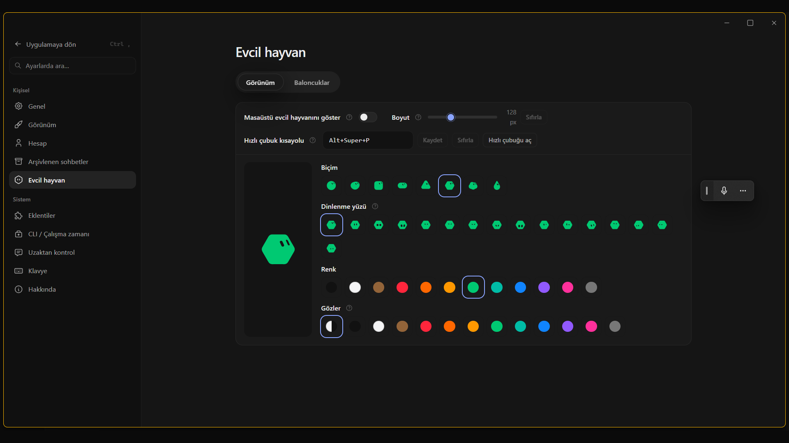

# Desktop pet & quick-access hub

The desktop pet (merged in #1348) is more than a mascot. Click it (or press `Alt+Win+P`) to open a
quick-access hub next to it, without bringing up the main window:

- **Prompt box**: `Enter` sends to the current chat in the background; `Ctrl+Enter` sends and opens the chat.
- **Voice dictation**: the microphone button turns speech into text in the prompt box.
- **Session switcher**: pinned and recent chats with live state. Chats waiting for approval float to the top.
  Search ignores case and diacritics.
- **Inline actions**: Approve / Deny on a chat waiting for approval, Stop on a running chat.
- **Saved prompts**: star up to 12 prompts for one-click reuse.
- **Motion**: the hub opens from the pet with a frosted-glass spring and staggered items.
- **Settings → Pet**: show/hide, size slider (px) and the quick-bar shortcut.

*Real screenshot of the app (Turkish UI). The quick bar is the vertical pill on the right edge.*

## Pairs well with PointHand

From the hub you can fire a prompt like *"Use PointHand to open Paint and draw a small fish"* at a chat
whose agent has the [PointHand](pointhand.md) MCP server. Then approve its tool calls right from the hub.
