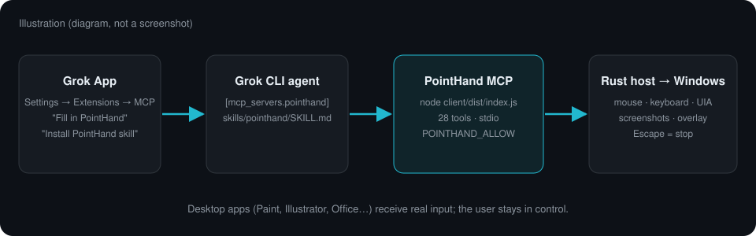

# PointHand: Windows'ta bilgisayar kullanımı

[English](pointhand.md)

<p align="center"></p>

[PointHand](https://github.com/ayzekhdawy/pointhand), açık kaynak (MIT) bir **Windows bilgisayar kullanımı MCP sunucusudur**.
Grok ajanının ekranı görmesini ve masaüstü uygulamalarında gerçek fare ve klavye girdisiyle çalışmasını sağlar:
tıklar, yazar, kaydırır, panoyu ve erişilebilirlik aksiyonlarını kullanır, pencere ekran görüntüsü alır, hatta
Paint'te çizim yapar. TypeScript MCP sunucusu (Node.js 20+) yerel bir Rust host ile konuşur. Tıklamayı engellemeyen
bir katman PointHand'in ne yaptığını gösterir ve **fiziksel Escape tuşu onu her an durdurur**.

| PointHand'in Paint'te çizdiği | Etkinlik katmanı |
| :---: | :---: |
|  |  |

*İki görsel de PointHand deposundan alınmıştır (gerçek çıktı). Aşağıdaki şema bir illüstrasyondur.*

<p align="center"></p>

## 1. PointHand'i kur

1. [PointHand sürümlerinden](https://github.com/ayzekhdawy/pointhand/releases) Windows x64 ZIP'ini ve `.sha256` dosyasını indir.
2. Doğrula (`Get-FileHash -Algorithm SHA256 <zip>`), sonra örneğin `C:\Tools\PointHand` klasörüne çıkar.
3. [Node.js 20+](https://nodejs.org/) kur.

## 2a. Uygulamada (önerilen)

1. **Ayarlar → Eklentiler → MCP → Sunucu ekle**'yi aç.
2. **PointHand'i doldur**'a tıkla. Form şöyle dolar:
   - Ad `pointhand`, Komut `node`
   - Argümanlar `C:/Tools/PointHand/client/dist/index.js`
   - Ortam `POINTHAND_ALLOW=mspaint.exe`
3. Yolu çıkardığın `client/dist/index.js` ile değiştir. `POINTHAND_ALLOW` değerine PointHand'in kontrol
   edebileceği programları virgülle yaz (boş bırakırsan tüm uygulamalar). Sonra **Ekle**'ye bas.
   Çalışan ajan yeniden başlar ve yeni sohbetler PointHand araçlarını alır.
4. İsteğe bağlı: **PointHand skill'ini kur**'a tıkla. Bu, paketteki
   [`skills/pointhand/SKILL.md`](../skills/pointhand/SKILL.md) dosyasını kullanıcı skill klasörüne yazar, böylece ajan
   bak → yap → doğrula akışını ve güvenlik kurallarını bilir. Var olan bir `pointhand` skill'inin üzerine asla yazılmaz.

## 2b. Terminalde Grok CLI

`~/.grok/config.toml` dosyasına ekle:

```toml
[mcp_servers.pointhand]
command = "node"
args = ["C:/Tools/PointHand/client/dist/index.js"]

[mcp_servers.pointhand.env]
POINTHAND_ALLOW = "mspaint.exe"
```

Sonra skill'i kopyala: `skills/pointhand/SKILL.md` → `~/.grok/skills/pointhand/SKILL.md`.
`pointhand`'in listede olduğunu görmek için `grok mcp list` çalıştır.

## 3. Dene

Boş bir Paint tuvali aç ve şunu iste:

> PointHand ile Paint penceresini incele, bir çizim aracı seç ve tuvalin ortasına küçük bir balık çiz.

İlk görevler için iyi örnekler: bir masaüstü formunu doldurmak, Gezgin'de dosya adlarını değiştirmek, bir ayarı değiştirmek ya da bir eskiz çizmek.
Portre akışının tamamı için [Mona Lisa rehberine](https://github.com/ayzekhdawy/pointhand/blob/main/examples/mona-lisa/README.md) bak.

## Güvenlik

- PointHand gerçek fareni hareket ettirir. Başında olduğun bir oturumda kullan.
- **Escape**, sunucu yeniden başlayana kadar tüm girdiyi durdurur. Ajan da `emergency_stop` çağırabilir.
- `POINTHAND_ALLOW` bir korkuluktur, kum havuzu değildir. Yönetici yetkili pencereler ve UAC istemleri girdiyi reddedebilir.
- PointHand'in [güvenlik politikasına](https://github.com/ayzekhdawy/pointhand/blob/main/SECURITY.md) bak.

PointHand şu an **alfa** sürümündedir (v0.2.0-alpha.5, 28 araç) ve yalnızca Windows 10/11'de çalışır.
